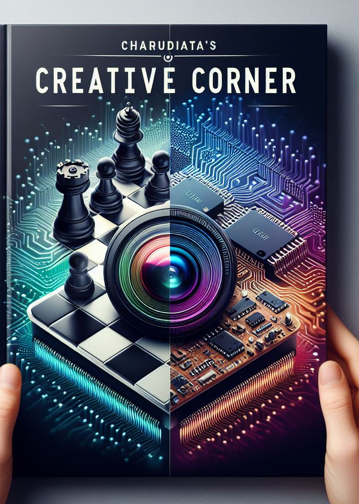

---

marp: true
theme: default
paginate: true

---

# Dr. Charudatta Gurudas Korde

Educator, researcher, engineer, and developer

---

## Walkthrough

- [About](#about)
- [Contact](#contact)
- [Education](#education)
- [Experience](#experience)
- [Projects](#projects)
- [Skills](#skills)
- [Publications](#publications)
  

---

## About

I completed my PhD at NIT Goa in 2025.

- Researched FPGA acceleration of generative AI on edge devices.
- Taught applied cybersecurity and basic electronics.
- Guided six master's students.
- Build open-source tools for AI, education, and software development.

---

## Contact

- [Email](mailto:korde.charudatta@gmail.com)
- +91 8275381582
- Goa, India
- [Portfolio website](https://charudatta10.github.io/portfolio/)
- [GitHub](https://github.com/charudatta10)
- [LinkedIn](https://www.linkedin.com/in/charudatta-korde/)

---

## Education

| Degree | Institution | Years | Grade |
| :--- | :--- | :--- | :--- |
| PhD in VLSI (AI on edge devices) | National Institute of Technology Goa | 2018–2025 | 8.6/10 CGPA |
| Master of Engineering in Microelectronics | Goa University | 2015–2017 | 8.0/10 CGPA |
| Bachelor of Engineering in Electrical and Electronics Engineering | Goa University | 2011–2015 | 76% |

---

## Doctoral Research

- Accelerated GANs on FPGA-based edge devices.
- Studied energy-efficient dataflow, quantization, and hardware–software co-design.
- Implemented GAN architectures using Verilog, NNGEN, and Xilinx Kintex-7.

---

## Experience

### Lecturer, NFSU (2024–2026)

Taught Incident Response and Vulnerability Assessment and Penetration Testing through applied cybersecurity labs and system-level analysis.

### Visiting Faculty, GPCM (2024)

Led Basic Electronics labs covering circuit fundamentals and measurement techniques.

---

### Freelancer, GITHUB *2015, remote

- FPGA based SVM implementation.
- FPGA based perceptron network implementation.
- Creating automation scripts for windows pc with powershell.

**Technologies used:** MATLAB, Powershell, Python, Vscode, Jupyter.

---

### Software Validation Engineer, Intel (2019, six months)

- Validated Quartus FPGA design flows from versions 19.3 through 20.1.
- Tested synthesis, implementation, bitstream generation, and hierarchical design flows.

---

## Projects

### ShardX

Peer-to-peer infrastructure for distributed model training and inference.

---

### GenAiTamago

- Built a Generative AI PyTorch tensor model aggregator project.
- Project include GAN, VanillaGAN, ConditionalGAN, DCGAN, WGAN.
- GenAiTamago is used to trace signal, and generate handwritten digits with given prompts.

---

### readme-generator

- Built a readme generator for github repo using python and jinja2.
- readme-generator has hero svg, dependency badges, status dynamic badges auto generated.

---

### LinkNet

- Built a python based link aggregator platform.
- LinkNet has custom icons configurable through json config file.
- LinkNet is flask app with static hosting options available.

---

### MyBlog

- Built a statics website using mkdocs to host portfolio. 
- MyBlog has blog section, portfolio section, home and about sections.

---

### legendary-dollop

- Built a SVG generator project.
- Project generates svg's such as glitch, luminance, badge etc.

---

### improved-barnacle

- Built python script to clean download directory.
- Project sorts through the files by extension and move files to folder.

---

## Skills

- **Programming**: Python, Verilog, Latex.
- **Deep learning tools**: PyTorch, Tensorflow, keras,
- **Deep learning models**: GAN, CGAN, WGAN, DCGAN.
- **Machine learning**: genetic algorithm, wavelet transform, MFDFA.
- **Artificial intelligence**: ollama, lamma3, gemma.
- **VLSI**: Quartus, Vivado, FPGA.
- **misc tools**: powershell, vscode, github, neovim.

---

## Articles

1. exploring the legendary dollop repository an svg generator
2. Organization schemes for note taking
3. VS Code for Note-Taking
4. Improved-Barnacle repository: (The Cleanup Python Script)
5. Vscode setup with Foam and Logseq for Digital Note Taking
6. Collaborative Note-Taking with AI: Tools that Facilitate Teamwork and Knowledge Sharing
7. Visual Note-Taking Apps: Unleashing Creativity with AI-Driven Mind Maps and Doodles
8. Introduction to Digital Note-Taking: A Beginner's Guide

---

## Publications

### Selected IEEE Access papers

- [MFDFA-Enhanced GAN: A Hardware-Optimized Architecture for Efficient Synthetic Image Generation](https://doi.org/10.1109/ACCESS.2026.3677066) (2026)
- [Evolutionary-Enhanced GAN With Wavelet-Based Discrimination: A Hardware-Accelerated Architecture for Efficient Synthetic Image Generation](https://doi.org/10.1109/ACCESS.2025.3642041) (2025)
- [Generating Synthetic Data Using 2D Multifractal Detrended Fluctuation Analysis Generative Adversarial Networks](https://doi.org/10.1109/ACCESS.2025.3603332) (2025)

---

## Conference Publications

| Title                                                                                          | Year | Type       | Publisher                                                                                       |
|------------------------------------------------------------------------------------------------|------|------------|-------------------------------------------------------------------------------------------------|
| Implementation of FPGA Based Pre-Processing Algorithms for Devnagri Script Recognition Systems | 2015 | Conference | IEEE Computer Society Annual Symposium on VLSI (ISVLSI)                                         |
| Multifractal analysis of ionospheric disturbances triggered by earthquakes                     | 2017 | Conference | 18th Annual conference of the International Association of Mathematical Geosciences (IAMG 2017) |

---

## Conference Publications (2018–2019)

| Title                                                                                          | Year | Type       | Publisher                                                                                       |
|------------------------------------------------------------------------------------------------|------|------------|-------------------------------------------------------------------------------------------------|
| FPGA Implementation of Square and Cube Architecture Using Vedic Mathematics                    | 2018 | Conference | IEEE 4th International Symposium on Smart Electronic Systems, iSES                              |
| Training of Generative Adversarial Networks with Hybrid Evolutionary Optimization              | 2019 | Conference | IEEE 16th India Council International Conference (INDICON)                                      |

---

## Conference Publications (2021)

| Title                                                                                          | Year | Type       | Publisher                                                                                       |
|------------------------------------------------------------------------------------------------|------|------------|-------------------------------------------------------------------------------------------------|
| Training of Generative Adversarial Networks using Particle Swarm Optimization Algorithm        | 2021 | Conference | IEEE International Symposium on Smart Electronic Systems (iSES)                                 |

---

# Thank You

